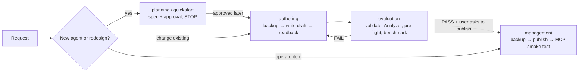

> **Telemetry — MANDATORY.** Every `api.fabric.microsoft.com` call must carry
> `x-ms-fabric-skill: dataagent-cli` (`az rest`: `--headers "x-ms-fabric-skill=dataagent-cli"`),
> including every LRO poll, `fabric_lro`, retry and MCP request. Snippets omit it — add it anyway.

> **CRITICAL NOTES**
> 1. To find the workspace details (including its ID) from workspace name: list all workspaces and, then, use JMESPath filtering
> 2. To find the item details (including its ID) from workspace ID, item type, and item name: list all items of that type (`DataAgent`, `Lakehouse`, `Warehouse`, `SemanticModel`, `KQLDatabase`, ...) in that workspace and, then, use JMESPath filtering
> 3. **Skill disambiguation**: use `dataagent-cli` for the **data agent item** and its configuration across any source type. Scoring or auditing readiness is the Fabric Data Agent Analyzer notebook. Editing the semantic model itself (descriptions, AI data schema, verified answers, AI instructions) is `semantic-model-authoring`. Lakehouse tables and Spark are `spark-cli`; read-only T-SQL on warehouses/SQL endpoints is `sqldw-cli`; Fabric SQL database is `sqldb-cli`; KQL tables and policies are `eventhouse-cli`; ontology items are `ontology-cli`; finding items across workspaces is `onelake-catalog-cli` / `search-consumption-cli`; Git sync is `git-integration-operations-cli`; deployment pipelines are `deployment-pipelines-authoring-cli`; asking questions of Power BI data is `fabriciq`. A deep, lakehouse-only remediation workflow also exists as `lakehouse-dataagent-remediation-cli`.
> 4. **Capacity boundary**: if Fabric returns `CapacityNotActive`, stop and tell the user. Never resume, scale or buy capacity on your own.

# Fabric Data Agent — CLI Skill

This skill owns the Fabric **data agent** lifecycle end to end: requirements and scope, creating the agent and attaching sources, writing the context that makes it accurate (descriptions, instructions, example queries, schema selection, routing), checking it against best practices, publishing, consuming it (MCP), and evaluating. Best practices are applied **per source type**, because each query tool (NL2SQL, NL2DAX, NL2KQL, GQL, AI Search) is configured differently.

It is a **mode dispatcher** and intentionally contains no detailed procedures. Select the mode, then read its reference end to end before acting. The mode file holds the workflow, payloads, templates and failure rules.

**Fast path.** For a new agent with a clear, small scope (1–2 sources), follow [references/quickstart.md](references/quickstart.md): condensed spec → approval → create → validate → pre-flight → publish on request. It keeps every gate below; it only removes ceremony.

## Mode selection

| Mode | Use when the request... | Example triggers | Read first |
|---|---|---|---|
| `planning` | starts a new agent, or a significant redesign, and needs requirements, source readiness, scope, and an approved spec before anything is built | create a data agent, build an agent over my lakehouse/model, which sources should the agent use, plan my agent | [references/planning.md](references/planning.md) (small scope: [references/quickstart.md](references/quickstart.md)) |
| `authoring` | creates or changes the agent **draft**: attach sources, select schema, write descriptions, instructions, example queries, routing; also improves an existing agent against best practices | add a lakehouse to the agent, write instructions, add example queries, fix routing, improve my agent, remediate analyzer findings | [references/authoring.md](references/authoring.md) |
| `evaluation` | tests quality: example validation, ground-truth questions, run-step inspection, Analyzer before/after, pre-flight checklist, MCP smoke test | evaluate my agent, did the changes help, test the agent, regression check, is my agent ready to publish | [references/evaluation.md](references/evaluation.md) |
| `management` | operates the item: list, get, export/backup, restore/rollback, publish (REST or SDK), revert draft to published, delete, ALM (Git, deployment pipelines), permissions, consumption (MCP, Microsoft 365 Copilot, Copilot Studio) | publish the agent, back up the agent, roll back, discard draft changes, delete the agent, promote to prod, connect the agent to VS Code / MCP | [references/management.md](references/management.md) |

Shared topic references (open from the mode file that needs them, once):

| Topic | Reference |
|---|---|
| Fast path for a new agent | [references/quickstart.md](references/quickstart.md) |
| Best-practice gate before "done" and before publish | [references/preflight-checklist.md](references/preflight-checklist.md) |
| Definition parts, schemas, element types per source | [references/definition-format.md](references/definition-format.md) |
| How to write descriptions, instructions, examples, selection (all sources) | [references/context-playbook.md](references/context-playbook.md) |
| Multi-source routing | [references/routing.md](references/routing.md) |
| Calling a published agent: MCP server, SDK, Microsoft 365 Copilot | [references/consumption.md](references/consumption.md) |
| SQL sources: lakehouse, warehouse, SQL database, mirrored database | [references/sources/sql.md](references/sources/sql.md) |
| Power BI semantic model | [references/sources/semantic-model.md](references/sources/semantic-model.md) |
| Eventhouse KQL database | [references/sources/kql.md](references/sources/kql.md) |
| Graph model, ontology, Azure AI Search (preview) | [references/sources/graph-ontology-search.md](references/sources/graph-ontology-search.md) |

## Mode Boundary Rules

- Classify by **intent**, not by which file is open.
- `planning` produces a spec; it builds nothing. `authoring` writes the draft from an approved spec (or, for a small focused edit, from the user's explicit instruction). `management` moves and operates the item; it does not invent configuration content. `evaluation` is read-only (example validation and MCP smoke tests only read data).
- A greenfield request spans modes in this order: `planning` → `authoring` → `evaluation` → `management` (publish).
- Improving an **existing** agent is `authoring` (assess → plan the changes → approval → apply); a focused single edit the user states explicitly ("add this instruction") may be applied directly after a backup.

> **APPROVAL BARRIER — MANDATORY.** For a new agent or a multi-change improvement, persist the plan (`_brief/dataagent-spec.md`, or `remediation-plan.md` for an existing agent), ask for explicit approval, and end the turn. In that turn do not create the item, write any definition, call Fabric write APIs, or publish. "Build it" in the original request is desired future scope, not approval. Never publish without an explicit request to publish.

## Required Deliverable by Mode

| Mode | Completion requirement |
|---|---|
| `planning` | Persist the spec, ask for approval, stop. |
| `authoring` | Backup, then a successful write (create, staging API or `updateDefinition`) **and** a readback that confirms every approved change, plus the pre-flight table. Draft only. |
| `evaluation` | Report validation results, Analyzer before/after, pre-flight status, what a static check cannot show, and next tests. |
| `management` | Complete the requested operation including LRO polling and a documented readback (after publish: export check + MCP smoke test). |

Producing the deliverable is completion. Advice, a plan the user did not ask for, or "you could now run …" is not.

## Rules

### MUST

- Read the selected mode reference **end to end** before the first command; open shared references only when the mode file points to them.
- Keep compact working state for the task (workspace/agent/source IDs, run folder, backup path, references already read) and reuse it instead of re-listing or re-reading.
- Resolve workspace, agent and source item IDs by listing and filtering; never guess a GUID.
- Read the source-type reference before writing source-level context: what is supported differs by source (for example, semantic models take **no** source instructions or description; example queries are not supported for them).
- Back up the full definition before any write; keep it in the run folder. Write the **draft** stage only; `published/` parts are sent back byte-for-byte.
- Send the **complete** definition on `updateDefinition` (full replace); an omitted part is deleted. For a single focused change prefer the granular staging APIs.
- Derive descriptions, values, joins and examples from evidence (metadata, profiling, existing docs). Mark anything unprovable `NEEDS_OWNER_REVIEW`; do not write it as fact.
- Validate example queries read-only against the source before writing them; drop failures.
- Run [references/preflight-checklist.md](references/preflight-checklist.md) on the exported draft before declaring authoring done and before publishing; report every `FAIL`.
- State preview limits honestly (runtime, SDK, DataAgent REST configuration APIs, graph/ontology/AI Search); report `NOT_SUPPORTED` / `NOT_EVALUATED` rather than a pass you did not observe.
- Respect the product limits: up to **5 sources** per agent, up to **100 example queries per source**, answers capped at **25 rows and 25 columns** (1,000 rows on the preview runtime), English only, source capacity in the **same region** as the agent, read-only queries only.

### PREFER

- The narrowest mode that covers the request; one mode at a time, announced.
- Fewer, clearer, business-named objects over broad selection; context placed at the right layer (see the playbook).
- Existing Analyzer evidence over re-deriving problems; the SDK (`fabric-data-agent-sdk`, preview) when it resolves a source's schema for you; the DataAgent staging APIs for focused edits; `updateDefinition` for bulk or multi-part edits.
- A specific publishing description (domain, sources, typical questions, exclusions) — it becomes the MCP tool description.
- Direct, imperative instructions ("Join `A` to `B` on `K`") over advice.

### AVOID

- Putting semantic-model instructions at the agent level (the DAX tool ignores them) — they belong in Prep for AI.
- Long routing-rule lists, copying whole schemas into instructions, or contradicting examples.
- Publishing, deleting, reverting the draft, or editing `published/` without an explicit request; resuming paid capacity; unbounded profiling scans.
- Wiring the agent into third-party MCP clients without telling the user that answers may leave Fabric's compliance boundary.
- Reloading this dispatcher or a reference already read in the current task.

## Route Compatibility

Older names and phrasings map to the current routes:

| If the request or a prior note says… | Use |
|---|---|
| "AI skill", "AISkill" item | data agent (`DataAgent` item type) — this skill |
| "few-shots", "sample questions", "example SQL" | example queries → `authoring` + [context-playbook.md](references/context-playbook.md) |
| "notes for the model", "AI instructions" on the agent | agent instructions (`aiInstructions`) → `authoring` |
| "AI instructions" / "verified answers" on a semantic model | Prep for AI → `semantic-model-authoring` |
| "Assistants API" client code | Responses API or MCP → [consumption.md](references/consumption.md) |
| "lakehouse remediation", "fix analyzer findings" (lakehouse only, deep) | `lakehouse-dataagent-remediation-cli` (or `authoring` for mixed sources) |

## Complete Reference Index

<!-- BEGIN GENERATED REFERENCE INDEX -->
| Reference | Purpose |
|---|---|
| [references/planning.md](references/planning.md) | Requirements, source readiness, context design, spec template, approval gate |
| [references/quickstart.md](references/quickstart.md) | Fast path for a new agent with best-practice defaults |
| [references/authoring.md](references/authoring.md) | Create the agent, attach sources, write draft context (REST, staging APIs, SDK) |
| [references/evaluation.md](references/evaluation.md) | Example validation, Analyzer before/after, benchmark, run steps, MCP smoke test |
| [references/management.md](references/management.md) | List, export, backup, restore, publish, revert, delete, ALM, permissions |
| [references/preflight-checklist.md](references/preflight-checklist.md) | Best-practice and anti-pattern gate |
| [references/consumption.md](references/consumption.md) | MCP server, SDK, Microsoft 365 Copilot and other consumers |
| [references/definition-format.md](references/definition-format.md) | Definition parts, JSON schemas, element types, API operations |
| [references/context-playbook.md](references/context-playbook.md) | Writing selection, descriptions, instructions and examples |
| [references/routing.md](references/routing.md) | Multi-source routing |
| [references/sources/sql.md](references/sources/sql.md) | Lakehouse, warehouse, SQL database, mirrored database |
| [references/sources/semantic-model.md](references/sources/semantic-model.md) | Power BI semantic model |
| [references/sources/kql.md](references/sources/kql.md) | Eventhouse KQL database |
| [references/sources/graph-ontology-search.md](references/sources/graph-ontology-search.md) | Graph model, ontology, Azure AI Search |
<!-- END GENERATED REFERENCE INDEX -->

## Examples

| User request | Mode |
|---|---|
| "Create a data agent over my sales lakehouse and finance semantic model." | `planning` (stop at approval) |
| "Quickly set up an agent over the Orders warehouse — just these 4 tables." | `planning` via quickstart (stop at approval) |
| "Add the approved descriptions and example queries to the agent." | `authoring` |
| "Change only the agent instructions." | `authoring` (backup → staging settings update → readback) |
| "My agent picks the wrong source — fix the routing." | `authoring` |
| "Is my agent ready to publish?" | `evaluation` (pre-flight checklist) |
| "Did the changes improve the agent? Test it with these 20 questions." | `evaluation` |
| "Publish the agent, but back it up first." | `management` |
| "Throw away my draft changes." | `management` (revert staging to published, after backup) |
| "Call the agent from Python / add it to VS Code as an MCP server." | `management` → [consumption.md](references/consumption.md) |
