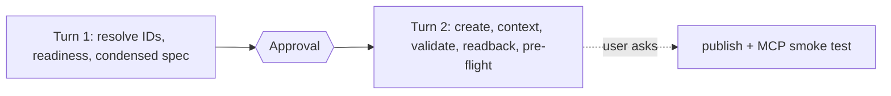

<!-- Topic reference for the `dataagent-cli` skill. Loaded on demand from `SKILL.md` (fast path) and `planning.md` for a new agent with a small, clear scope. -->

# Quickstart — a best-practice agent in two turns

For a **new** agent with 1–2 sources and a scope the user already knows. Larger or unclear scopes use the full [planning.md](planning.md). The gates do not change: turn 1 ends at approval, and nothing is published unless the user asks.



## Turn 1 — spec (read-only)

1. Resolve workspace, source item IDs and types by listing and filtering (SKILL.md critical notes). Confirm region, active capacity and read access.
2. Read the source-type reference for each source (once) and profile only what the questions need: object names, grain, keys, stored values for filter columns, date columns.
3. Fill the condensed spec below with **evidence-based defaults**. Write `_brief/dataagent-spec.md`, summarize it, ask for approval and the open owner decisions, then **end the turn**.

````markdown
# Data agent spec (quick) — <name> (<UTC>)
Workspace: <name> | Sources: <item (type)>, ... | Runtime: standard (default) | preview (needs owner acceptance)
Purpose / audience: <one line>
Publishing description (draft): <domain; sources; 3 typical questions; what it does not answer>

## Selection (per source)
Include: <tables/views/functions needed by the questions>   Exclude: <staging, raw, audit, temp, duplicates>

## Source description (SQL/KQL/graph; not semantic models)
<1-2 sentences: contents, questions answered, why authoritative>

## Source instructions (SQL/KQL/graph)
General knowledge: <grain, units, time zone>
Table descriptions: <table — one row per …; key columns>
When asked about <topic>: <table, join keys, filters, calculation>
Joins: <A.k = B.k>  Business values: <term → stored value>  Time: <default date column, fiscal year start>

## Agent instructions
Objective / Data sources / Key terminology / Response guidelines / Handling common topics

## Example queries (SQL/KQL/graph; 5-15 to start, validated before writing)
| Question | Query pattern | Literals mapped |

## Semantic model (if any)
Prep for AI items for `semantic-model-authoring` (AI data schema, verified answers, AI instructions)

## Evaluation set
<10 questions with expected answers>

## Owner decisions
<runtime, unprovable meanings marked NEEDS_OWNER_REVIEW>
````

Defaults that need no question: standard runtime; minimal selection; English; summary + table answers that state filters and date range; out-of-scope line; one authoritative source per topic.

## Turn 2 — build (after explicit approval)

Read [authoring.md](authoring.md) end to end, then:

| Step | Do | Reference |
|---|---|---|
| 1 | Create the agent draft-only: `POST /workspaces/{ws}/dataAgents`, then `POST .../staging/datasources` per source (or SDK `create_data_agent` + `add_staging_datasource`) | authoring A0 / Route 2 |
| 2 | Export once → `before/` (baseline backup) | management |
| 3 | Selection and object descriptions: `PATCH .../staging/datasources/{ds}/elements?id=` | authoring A0 |
| 4 | Source description + instructions: `PATCH .../staging/datasources/{ds}` (skip for semantic models) | context-playbook |
| 5 | Agent instructions: `PATCH .../staging/settings` | context-playbook |
| 6 | Examples: run each read-only and bounded; write passing ones with `POST .../fewshots`; read `validationStatus`; SQL: `evaluate_few_shots` until no conflicts | authoring C, evaluation |
| 7 | Readback (export → `after/`), Analyzer before/after, [preflight-checklist.md](preflight-checklist.md) A–G | evaluation |
| 8 | Report: what was written, pre-flight table, evaluation status, next step (benchmark, publish) | — |

If the dedicated APIs are unavailable in the tenant (preview), fall back to the SDK or a single `updateDefinition` (authoring A Route 1 / B); everything else stays the same.

## Publish (only when asked)

Run pre-flight section H, back up, then `POST .../dataAgents/{id}/staging/publish` with the approved description ([management.md](management.md)). Export to confirm, then run the MCP smoke test in [consumption.md](consumption.md).
